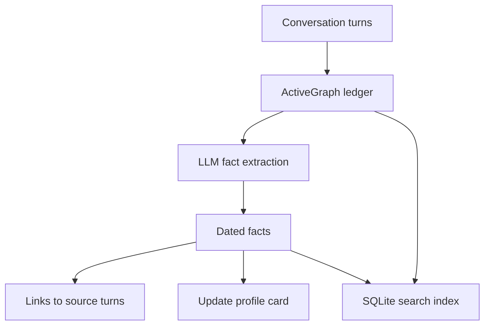
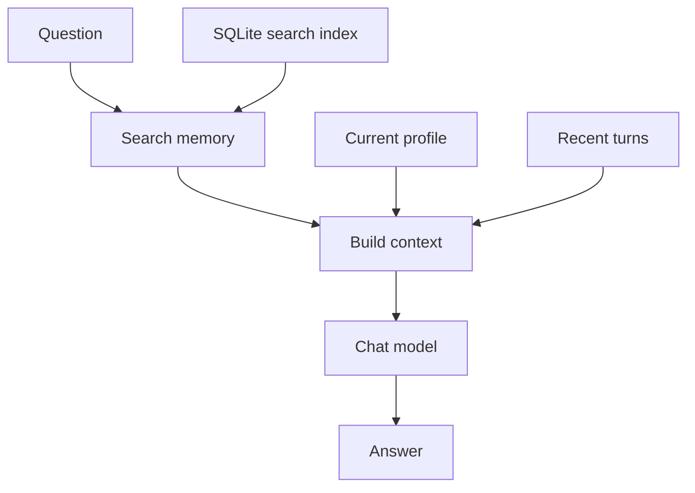

# Mnemos

Mnemos is a local memory system for AI agents. It stores conversations, extracts dated facts, and keeps links from those facts back to the original messages. An agent can retrieve earlier context and show where a remembered detail came from.

For example, if you change jobs, Mnemos keeps both updates. You can ask about your current job, look up what it knew before the change, or inspect the messages behind an answer.

## How it works

1. Record conversation turns in an append-only ledger.
2. Extract dated facts and link them to their source turns.
3. Search both original messages and extracted facts with SQLite full-text search.
4. Build answers from retrieved context and a compact profile.

The ledger uses [ActiveGraph](https://docs.activegraph.ai), a separate dependency. Mnemos adds the memory extraction, retrieval, source tracing, CLI and browser interface.

## Architecture

### Storing memory



Original turns and extracted facts live in the ledger. Each fact has
`derived_from` links to its source turns. Both turns and facts enter the search
index; an LLM merges new facts into the current profile.

### Answering a question



Search combines keyword matching, recency ranking and a recent-fact fallback.
The context includes recent conversation when supplied. Historical questions
omit the current profile. The separate `why` command follows source links to
show the original user messages.

The ledger is the durable record. The search index and profile are rebuildable
views of it. Interactive chat schedules extraction after replying; one-shot
`ask` runs extraction before exiting. MCP exposes memory operations to another
agent rather than running this answer pipeline itself.

Facts keep two dates: when something happened (`date`) and when it was learned
(`learned`). An `asof` query filters on the learned date and omits the current
profile so later updates cannot leak through that card. Retrieval uses lexical
search and a recent-fact fallback, not embeddings; it can miss relevant context.

## Example: remembering a job change

This fictional example illustrates the flow, not a measured model transcript.
Assume each exchange has been recorded and digested on the date shown.

| Recorded on | User message | Illustrative extracted fact |
|---|---|---|
| June 1 | “I work at Cedar as a designer.” | `state \| 2026-06-01 \| works at Cedar as a designer` |
| July 10 | “I left Cedar and joined Maple as a researcher today.” | `state \| 2026-07-10 \| works at Maple as a researcher` |

The old turns and facts remain in the ledger. The profile is updated to reflect
Maple, and the new fact links back to the July message.

```bash
uv run mnemos ask "Where do I work?"
# Intended answer: Maple, using the latest update.

uv run mnemos asof 2026-06-20 "Where do I work?"
# Intended answer: Cedar. The July update was not known on June 20.

uv run mnemos why "Maple"
# Displays matching facts and their original user messages, for example:
# [2026-07-10] (state) works at Maple as a researcher
#     receipt: "I left Cedar and joined Maple as a researcher today."
```

`why` may return additional facts because recall includes a recent-fact fallback.
Its receipts come from stored source links; the first two answers are generated
by a model and can be wrong. If the July message instead reported a change that
happened in May, an as-of-June query would still exclude it: this is **what was
known then**, not a reconstruction using facts learned later.

## Run locally

Requires Python 3.12+ and [uv](https://docs.astral.sh/uv/).

```bash
git clone https://github.com/debsagar/mnemos.git
cd mnemos
uv sync --locked
export OPENROUTER_API_KEY="your-key"
uv run mnemos chat
```

Model calls use your configured provider and may incur charges. Set `MNEMOS_CHAT_MODEL` and `MNEMOS_EXTRACT_MODEL` to choose models, or `MNEMOS_API_URL` for a compatible endpoint.

```bash
uv run mnemos recall "work"              # retrieve dated facts
uv run mnemos why "work"                 # inspect source messages
uv run mnemos asof 2026-06-20 "Where do I work?"
uv run mnemos digest                     # extract facts from pending turns
uv run mnemos serve                      # local browser interface
```

Memory is stored in `~/.mnemos/` by default. Retrieved context is sent to the configured model provider. The browser agent can execute shell commands as your user; keep it on localhost and use it only in a trusted environment. Its visualization loads libraries from public CDNs.

## MCP integration

Run `uv run python -m mnemos.mcp_server` from this checkout, or configure an MCP client to launch `.venv/bin/python -m mnemos.mcp_server` with this checkout as its working directory. The stdio server exposes `remember`, `recall`, `why`, `due` and `stats`. Set `MNEMOS_HOME` to choose its memory directory. `remember` starts model-based extraction in the background; the read tools work without an API key.

## Check without an API key

```bash
uv run python test_core.py
uv run python test_mcp.py
```

The check uses fake model replies and temporary memory. It covers source links, extraction failures, interrupted exchanges, background digestion and recorded tool calls. It does not measure model quality.

## Scope

This is a research prototype. Extraction and answers can be wrong; preserving a source does not make an extracted fact correct. The search index and profile can be rebuilt from the ledger. Historical benchmark experiments and private conversation databases are not included in this release, so this README makes no benchmark superiority claims.

## License

MIT. Developed by Sagar Deb. ActiveGraph is maintained separately and retains its own license.
